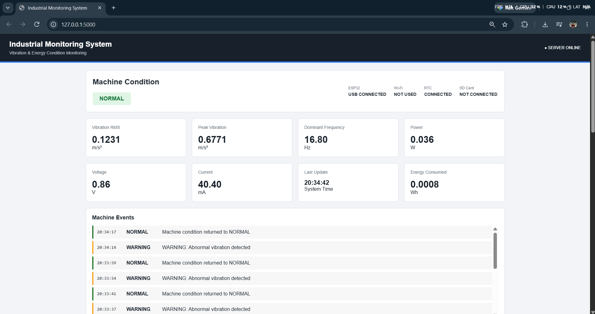
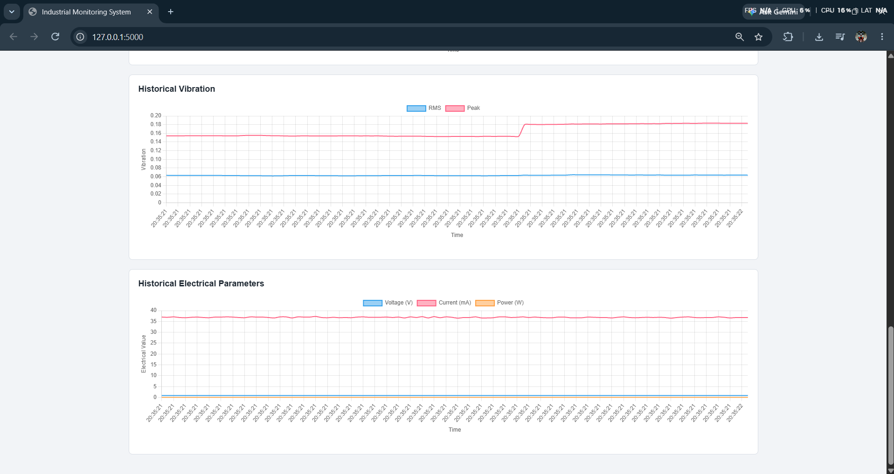
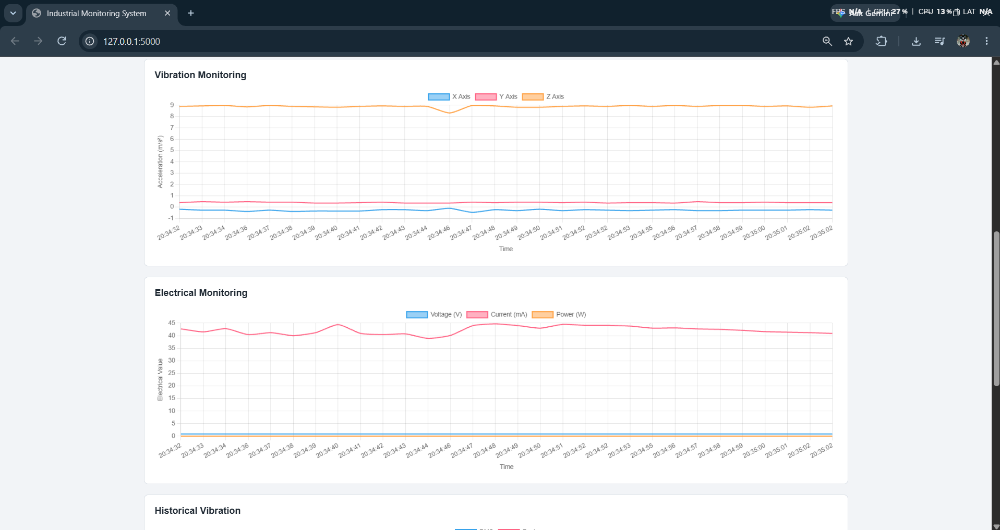

# Industrial Monitoring System

A real-time machine condition monitoring dashboard built with an **ESP32**, an **ADXL345** accelerometer, an **INA219** power monitor and a **DS3231** RTC. Sensor data is streamed over USB serial to a **Flask** server that computes vibration features, classifies machine condition and serves a live web dashboard.



## Features

- Live vibration monitoring (X / Y / Z acceleration)
- Vibration analysis: **RMS**, **peak**, and **dominant frequency** (FFT)
- Electrical monitoring: voltage, current, power and accumulated energy (Wh)
- Automatic condition classification: `NORMAL` / `WARNING` / `DANGER`
- Machine event log (condition changes with timestamps)
- Hardware status panel (ESP32, Wi-Fi, RTC, SD card)
- Historical charts and automatic CSV data logging

## Screenshots

| Live monitoring | Historical data |
|---|---|
|  |  |

## How it works

```
ADXL345 ─┐
INA219  ─┼─► ESP32 ──USB serial (CSV lines)──► esp32_serial.py ──HTTP POST──► Flask (app.py) ──► Dashboard
DS3231  ─┘                                                                        │
                                                                                  └─► data/machine_data.csv
```

The ESP32 prints one CSV line per sample over serial:

```
date,time,x,y,z,voltage,current,power
```

`esp32_serial.py` reads those lines and POSTs them to `/api/esp32`. `app.py` buffers a window of samples (`VIBRATION_WINDOW_SIZE`), and `processor.py` removes the DC/gravity component and computes RMS, peak and the dominant frequency.

## Project structure

```
├── app.py              # Flask server, REST API, CSV logging
├── esp32_serial.py     # USB serial -> Flask bridge
├── processor.py        # Vibration signal processing (RMS, peak, FFT)
├── config.py           # Thresholds, sample rate, server settings
├── templates/          # dashboard.html
├── static/             # dashboard.js, style.css
├── data/               # sample_data.csv (real logs are git-ignored)
├── docs/images/        # screenshots
└── START_DASHBOARD.bat # one-click launcher (Windows)
```

## Getting started

**Requirements:** Python 3.9+ (developed on 3.13)

```bash
git clone https://github.com/Rohannargundkar/IndustrialMonitoring.git
cd IndustrialMonitoring

python -m venv .venv
.venv\Scripts\activate          # Windows
# source .venv/bin/activate     # Linux / macOS

pip install -r requirements.txt
```

### Run the system

1. Connect the ESP32 over USB and find its port (e.g. `COM5`, or `/dev/ttyUSB0`).
2. Set `PORT` and `BAUD_RATE` at the top of `esp32_serial.py` (default `COM5` @ `115200`).
3. Start the system:
   - **Windows:** double-click `START_DASHBOARD.bat`
   - **Manual:** run `python app.py`, then `python esp32_serial.py` in a second terminal.
4. Open http://127.0.0.1:5000

## Configuration

Edit `config.py`:

| Setting | Default | Description |
|---|---|---|
| `ESP32_SAMPLE_RATE_HZ` | 100 | Sensor sampling rate |
| `VIBRATION_WINDOW_SIZE` | 256 | Samples per analysis window |
| `RMS_WARNING_THRESHOLD` | 0.30 | RMS above this → WARNING |
| `RMS_DANGER_THRESHOLD` | 0.80 | RMS above this → DANGER |
| `SERVER_HOST` / `SERVER_PORT` | 127.0.0.1 / 5000 | Flask server address |
| `ESP32_TIMEOUT_SECONDS` | 3.0 | Time before ESP32 is flagged disconnected |

> The vibration thresholds are demonstration values only and are **not** industrial standards (e.g. ISO 10816). Calibrate them for your own machine.

## API

| Endpoint | Method | Description |
|---|---|---|
| `/` | GET | Dashboard |
| `/api/data` | GET | Latest processed reading |
| `/api/status` | GET | Hardware / connection status |
| `/api/events` | GET | Machine event log |
| `/api/history` | GET | Historical data |
| `/api/esp32` | POST | Receives raw ESP32 samples |

## Tech stack

Python · Flask · NumPy · PySerial · Chart.js · HTML/CSS/JS · ESP32 · ADXL345 · INA219 · DS3231

## License

MIT, see [LICENSE](LICENSE).
